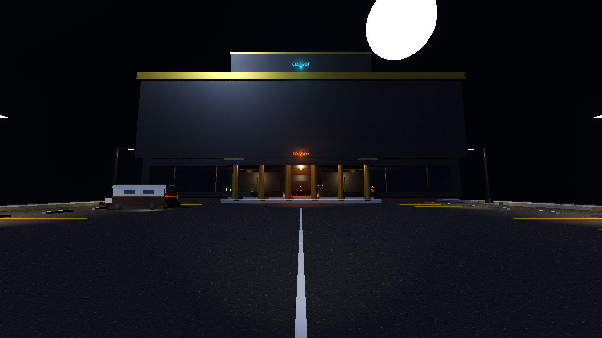

# 🍺 Stumble Home

**Four drunks. One city. Zero sense of direction.**

Stumble Home is a 4-player online co-op party game for 18+ players. You and three mates have had a *few* too many, the night is over, and everyone needs to get home before the cops catch up with you. Wobble through the streets, dodge trouble, survive the kebab shop, and keep the wanted level down. Nobody gets left behind. Probably.

> **Status:** early design / pre-production. This README is the game's blueprint. Everything below is what we're building, not what's playable today.

---

## At a glance

| | |
|---|---|
| Genre | Co-op party / chaos game |
| Players | 4 (online, room code) |
| View | 3D third-person |
| Look | Low-poly cartoon, silly |
| Engine | Godot 4 |
| Platform | Windows PC (v1) |
| Rating | 18+ (booze, swearing, slapstick) |
| Structure | Campaign, one level per night |
| Session | ~10-15 min per night |

---

## The idea

Every player is a different kind of drunk. Together you share one goal: **get the whole crew to the front door of home**. The streets are against you, your own legs are against you, and the cops are slowly noticing. You win by cooperating, and you lose by cooperating badly.

---

## How a night works

1. **Lobby.** One player creates a room and gets a short room code. Three friends join with it. Everyone picks a drunk type.
2. **Start.** The crew is dumped outside the last bar of the night. Home is marked on the map.
3. **Stumble.** Walk (badly) through the city, passing street hazards and optional mini-game stops along the way.
4. **Manage the chaos.** Keep your sobriety in check, keep the wanted level down, and pick up your fallen friends.
5. **Finish.** All four players must reach the front door. Hit the finish together and the night is cleared, unlocking the next one.
6. **Fail.** If the wanted level fills up, the cops arrest the group and the night restarts.

---

## Core systems

### Wobbly movement
Controls are deliberately unreliable. You sway, drift, over-correct and trip over kerbs. The drunker you are, the more your steering lags and veers. Movement is physics-driven so collisions with friends, bins and lampposts are funny by default.

### Sobriety meter
Each player has a personal sobriety meter.

- **Drinking** pushes it down: stronger quirks, wilder movement, but unlocks your drunk-type ability.
- **Sobering up** (water, food, a nap on a bench) pushes it up: steadier steering, but your ability weakens.
- Hit rock bottom and you pass out. A teammate must wake you up.

Too sober and you're boring. Too drunk and you're horizontal. The sweet spot is the game.

### Wanted level
A shared team meter. It rises when the crew does dumb things and falls when you lie low.

- **Goes up:** shouting, smashing stuff, fighting, running red lights, being loud near police, failing mini-games.
- **Goes down:** hiding, behaving, ditching the scene, bribing or distracting.
- **Full bar:** cops arrest the whole group and the night restarts.

### Co-op revive and carry
A passed-out friend can be dragged, carried, splashed with water or slapped awake. Leaving someone behind is allowed, but it won't save the night.

---

## The four drunk types

Pick one in the lobby. Each has a strength, a weakness and an ability. (Numbers are starting points for playtesting.)

| Drunk | Vibe | Strength | Weakness | Ability |
|---|---|---|---|---|
| **The Sloppy** | Friendly and floppy | Great at carrying and reviving friends | Worst steering of the crew | *Bear Hug:* scoops up a teammate and hauls them along |
| **The Aggressive** | Picks fights with everything | Can shove obstacles and enemies out of the way | Raises wanted level fastest | *Shoulder Charge:* smashes through blockers (at a wanted-level cost) |
| **The Sleepy** | Barely awake | Passive sobriety recovery, stays calm near cops | Slow, and falls asleep when idle | *Power Nap:* heals a nearby friend's sobriety, but they're stuck still |
| **The Hyper** | Can't stop moving | Fastest runner, great for scouting | Hardest to control, crashes into stuff | *Sugar Dash:* short burst of speed over gaps and hazards |

Roles are designed so the crew **needs** each one: nobody can do a night alone.

---

## Street hazards

- **Traffic:** cross roads without becoming a bonnet ornament.
- **Stray dogs:** chase you, steal dropped food.
- **Puddles and ice:** send you sliding.
- **Cops on patrol:** wander and notice rule-breaking. Their vision cones are visible, so sneak.
- **Muggers:** steal items and force a mini-game to get them back.
- **Pigeons and bins:** low-key slapstick.
- **Stairs and kerbs:** fall-over triggers.

---

## Mini-games

Optional stops that give rewards (sobriety boosts, shortcuts, wanted-level relief). Everyone on the team can take part, and teamwork usually matters.

- **Kebab shop:** order and eat without dropping it. Restores sobriety.
- **Door unlock:** match the right key to the lock while your hands shake. Used at the finish.
- **Texting:** type a sensible message while autocorrect and your thumbs fight you.
- **Call a cab:** drunk phone navigation to book a ride shortcut.
- **Bribe the bouncer / dodge the cop:** quick-time bluffing.

---

## Campaign: one level per night

Each night is a self-contained level in a different part of the city. They get harder and weirder.

| Night | Theme | New twist |
|---|---|---|
| 1 | Quiet suburbs | Tutorial pacing, basic hazards |
| 2 | City centre | Traffic and heavy cop patrols |
| 3 | Riverside | Slippery paths, bridges, ferries |
| 4 | Festival | Crowds, noise raises wanted level |
| 5 | Industrial estate | Dark, maze-like, muggers |

More nights come after launch. Levels are built to be replayed for faster clears and fewer arrests.

---

## Multiplayer

- 4 players, online, joined by a **room code**.
- Powered by **Epic Online Services (EOS)**:
  - **Lobbies** hold the room code and the player list.
  - **P2P networking** carries gameplay traffic, with Epic's relay servers as the fallback so nobody has to port-forward.
  - **Anonymous device-ID login** means players don't need an Epic account to play.
- One player hosts; the others join with the code.
- Godot talks to EOS through [EOSG](https://github.com/3ddelano/epic-online-services-godot) (MIT, Godot 4.2+), using its `EOSGMultiplayerPeer` so normal Godot RPCs and spawners work over EOS P2P.
- Co-op only, no PvP, so lag and desync don't ruin a rival's night.

---

## Art and audio

- Low-poly, bright, cartoon look with chunky silly characters.
- Ragdoll physics for stumbles, faints and fights.
- Neon-lit streets, glowing kebab shops, wobbly blurry vision that scales with how drunk you are.
- Upbeat, slightly off-key soundtrack. Slurry voice lines and big comedy sound effects.

---

## Roadmap

1. **Vertical slice:** one night, 2 hazards, 1 mini-game, 2 drunk types, local test with networked movement.
2. **Playtest build:** all 4 drunk types, wanted level, room-code lobby, 3 nights.
3. **Alpha:** full campaign, all mini-games, polish and balance pass.
4. **Release:** Windows build, store page, post-launch nights and cosmetics.

---

## Building

Requires **Godot 4.4+** (4.2 is the plugin minimum).

1. Clone this repo.
2. Download the EOSG **2.3.1** Windows release from the [EOSG releases page](https://github.com/3ddelano/epic-online-services-godot/releases/tag/2.3.1) and copy its `addons/epic-online-services-godot/bin/` folder into this repo's `addons/epic-online-services-godot/`. The binaries include Epic's SDK, so they're git-ignored and not stored here.
3. Create a product in the Epic Developer Portal and add your product ID, sandbox ID, deployment ID and client credentials to a local `eos_credentials` file (git-ignored; never commit secrets).
4. Open the project folder in Godot.
5. Run the main scene.

### Vertical slice prototype (Current build)

The initial 3D vertical slice prototype is integrated in this repository, featuring the outside of the bar at night (*ceaser* pub & casino with panoramic lit windows), an interactive parking lot, an enterable camper van, NPCs with dialogue, and core movement/sobriety mechanics:

- **Run in Godot**: Launch Godot 4.4+ and run `res://scenes/main.tscn`.
- **Movement**: <kbd>W</kbd><kbd>A</kbd><kbd>S</kbd><kbd>D</kbd> + 360° mouse look.
- **Interactions**: <kbd>E</kbd> to talk to NPCs or enter/exit the van.
- **Substances & Sobriety**:
  - <kbd>1</kbd> or **Mouse Scroll Wheel Down**: Realistic cigarette sequence — takes cigarette out to screen center-bottom, ignites tip with lighter in right hand, and uses mouse scroll wheel down to drag and smoke until it finishes.
  - <kbd>2</kbd>: Drink beer (restores buzz; tilts nozzle straight to mouth; inverts WASD at $\ge$30% drunk and mouse look at $\ge$60% drunk).
  - <kbd>3</kbd>: Energy drink (sobers up, resets drunkenness/smoke, restores buzz).
- **Coma / Pass-out**: Inactivity depletes your buzz meter; hitting 0% causes you to pass out and enter a coma (<kbd>R</kbd> or <kbd>Space</kbd> to wake up and restart).

---

## Contributing

Playtests, ideas and pull requests are welcome. Open an issue with your best drunk-story-inspired mechanic.

---

*Please drink responsibly in real life. In Stumble Home, we make no such promises.*
